# Przewodnik po aplikacji „Usterki na planie”

Dokument dla osoby, która ma poznać całą aplikację: co widać na ekranach, gdzie leży kod, jak działa logika i gdzie zapisują się dane. Screenshoty: `docs/screenshots/after/` (nowy wygląd) i `docs/screenshots/before/` (stary). Pliki `desktop-*` – komputer 1366 px, `mobile-*` – telefon 390 px.

## 1. Do czego służy

Inspektor chodzi po budynku z telefonem, wrzuca **plan (PDF/JPG)**, klika w nim miejsce usterki (**pinezka**), opisuje ją i robi **zdjęcie „przed”**. Gdy wykonawca naprawi, dodaje się zdjęcie „po” – usterka sama zmienia status na usuniętą. Na koniec jednym przyciskiem powstaje **protokół PDF lub Word**, zapisany też w archiwum i (opcjonalnie) w **SharePoint**.

## 2. Mapa ekranów

| # | Ekran | Adres | Plik | Screenshot |
|---|---|---|---|---|
| 1 | Logowanie | `/login` | `pages/LoginPage.tsx`, `layouts/AuthLayout.tsx` | `desktop-01-logowanie.png` |
| 2 | Lista inwestycji | `/` | `pages/ProjectListPage.tsx` | `desktop-02-inwestycje.png` |
| 3 | Inwestycja (dane, plany, usterki, raporty) | `/projects/:id` | `pages/ProjectPage.tsx` | `desktop-03-inwestycja.png` |
| 4 | Przeglądarka planu z pinezkami | `/projects/:id/plans/:planId` | `pages/PlanPage.tsx`, `components/plan/PlanViewer.tsx` | `desktop-04-plan.png` |
| 5 | Formularz usterki (panel) | ten sam adres, `?defect=<id>` otwiera usterkę | `components/defect/DefectForm.tsx` | `desktop-05-usterka.png` |
| 6 | Tworzenie raportu (panel) | na ekranie 3 | `components/report/ReportSheet.tsx` | `desktop-06-raport.png` |
| 7 | Ustawienia organizacji | `/settings` | `pages/SettingsPage.tsx` | `desktop-07-ustawienia.png` |
| 8 | Nowa / edycja inwestycji (panel) | na ekranach 2 i 3 | `components/project/ProjectForm.tsx` | `desktop-08-nowa-inwestycja.png` |
| 9 | Strona startowa (publiczna) | `/welcome` | `pages/LandingPage.tsx` | `desktop-09-strona-startowa.png` |
| 10 | Logowanie e-mail + hasło | `/login` | `pages/LoginPage.tsx` | `desktop-10-logowanie-haslo.png` |
| 11 | Rejestracja konta | `/login?mode=register` | `pages/LoginPage.tsx` | `desktop-11-rejestracja.png` |
| 12 | Subskrypcja i plany | `/subscription` | `pages/SubscriptionPage.tsx` | `desktop-13-subskrypcja.png`, `desktop-14-subskrypcja-pro.png` |

### 1. Logowanie
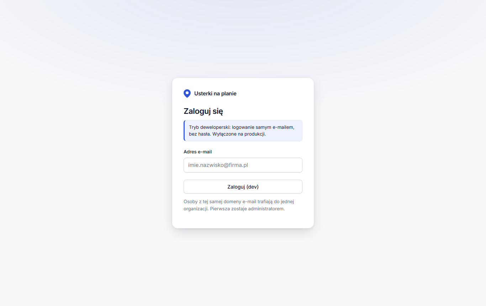
Lokalnie wystarczy e-mail (tryb dev). Na produkcji przycisk „Zaloguj kontem Microsoft”. Osoby z tej samej domeny e-mail trafiają do jednej organizacji; pierwsza zostaje administratorem.

### 2. Lista inwestycji
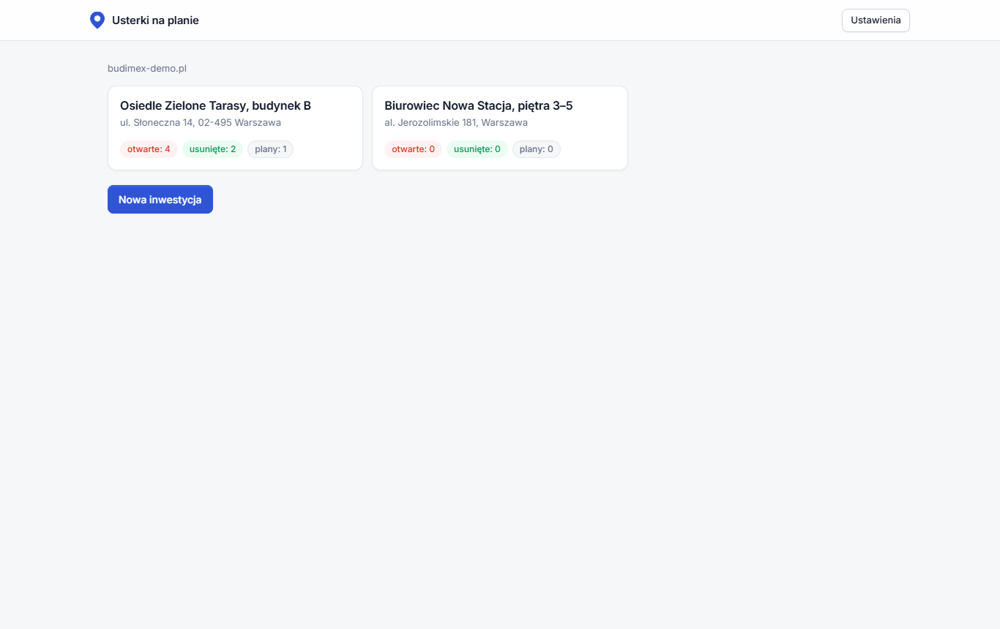
Karty inwestycji z licznikami: otwarte / usunięte / plany. „Nowa inwestycja” otwiera formularz (ekran 8).

### 3. Inwestycja
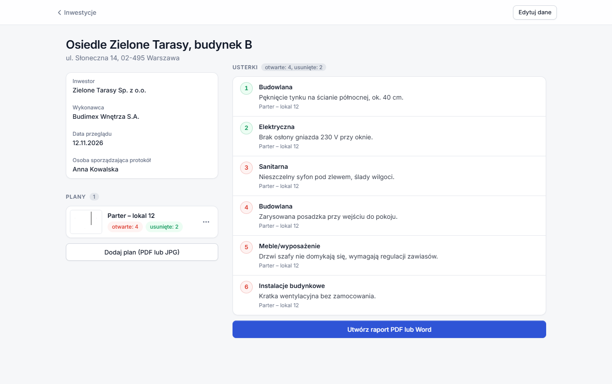
Lewa kolumna: dane protokołu i plany (miniatura + liczniki, menu „…” = zmiana nazwy/usunięcie, „Dodaj plan”). Prawa: lista wszystkich usterek (klik → plan z podświetloną pinezką), przycisk raportu i archiwum wygenerowanych raportów. Dopóki dane inwestycji nie są kompletne (`is_complete`), nie da się dodać planu.

### 4. Plan z pinezkami
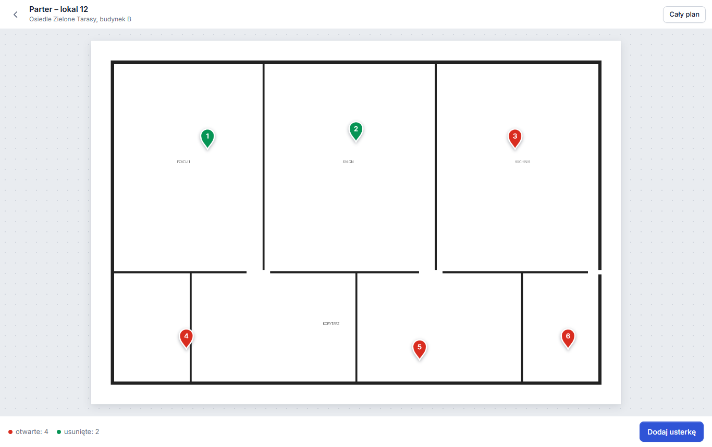
Przesuwanie, zoom (kółko, dwuklik, pinch na telefonie). Czerwona pinezka = otwarta, zielona = usunięta. „Dodaj usterkę” przełącza w tryb dodawania: klik w plan ustawia pinezkę i otwiera formularz. Wersja mobilna: `screenshots/after/mobile-04-plan.png`.

### 5. Formularz usterki
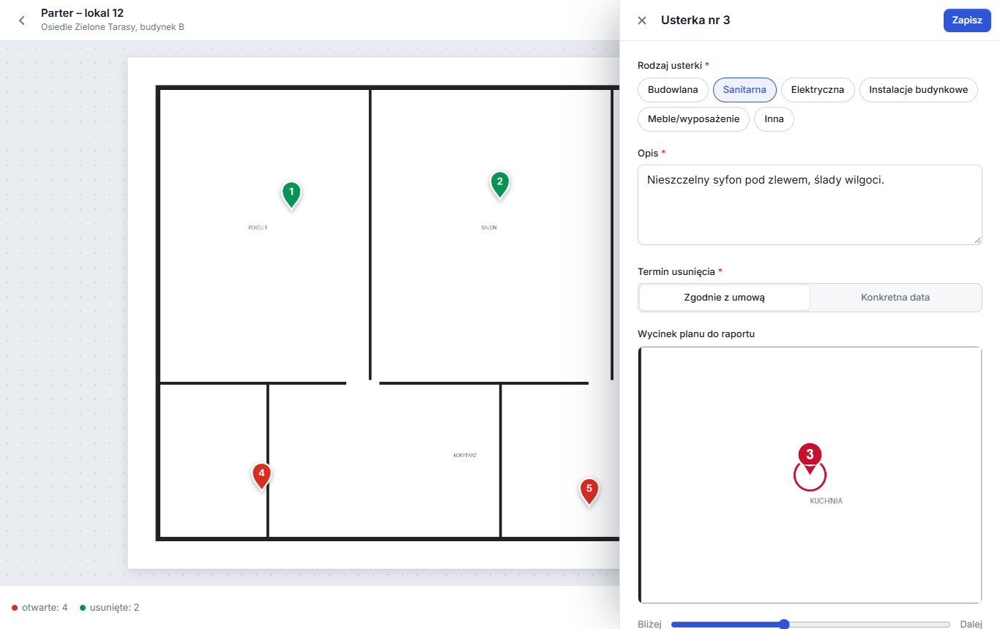
Rodzaj (lista z ustawień organizacji), opis, termin (zgodnie z umową / data), wycinek planu do raportu z suwakiem zasięgu, zdjęcia „przed” i „po”, przeniesienie pinezki, usunięcie. Na desktopie to panel z prawej, na telefonie pełny ekran.

### 6. Raport
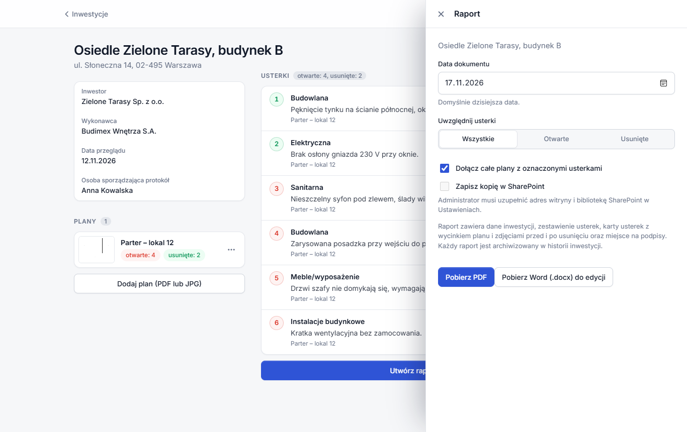
Data dokumentu, filtr (wszystkie / otwarte / usunięte), czy dołączyć całe plany i logo, czy wysłać kopię do SharePoint, format PDF lub Word.

### 7. Ustawienia
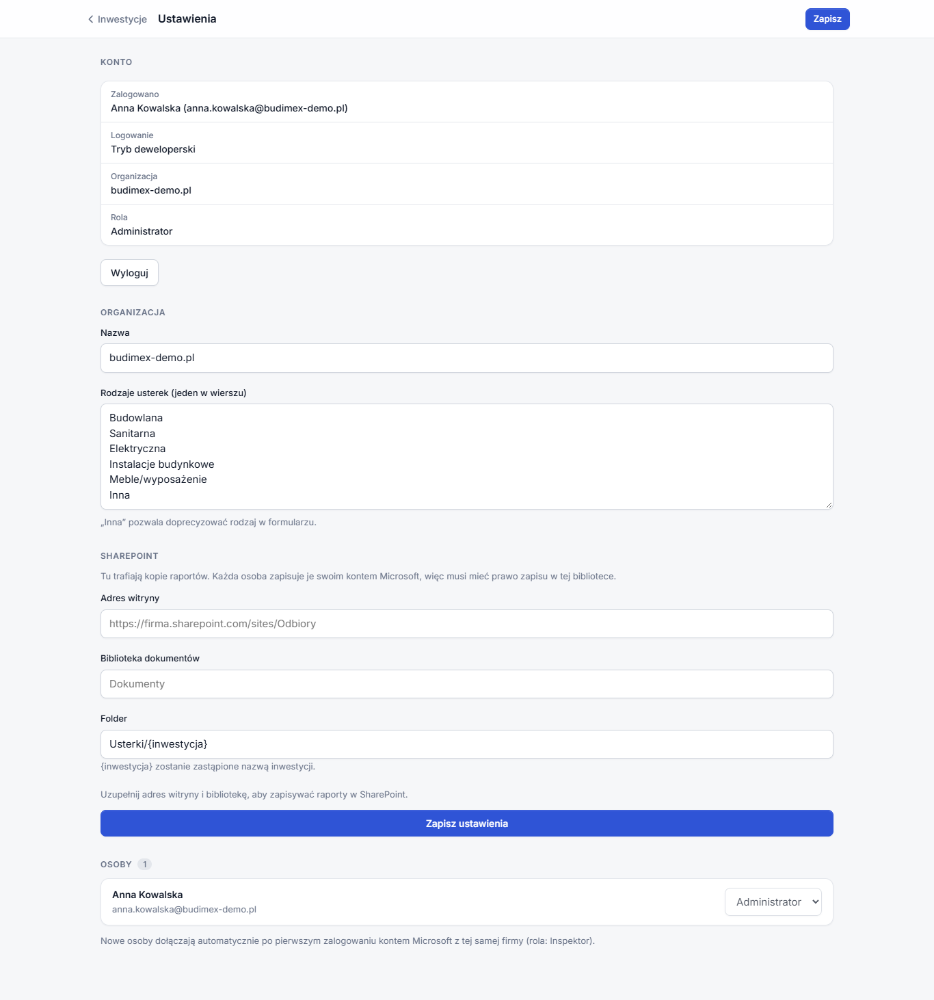
Administrator: rodzaje usterek, adres witryny/biblioteki/folderu SharePoint, role osób (admin / inspektor / podgląd).

### 8. Nowa inwestycja
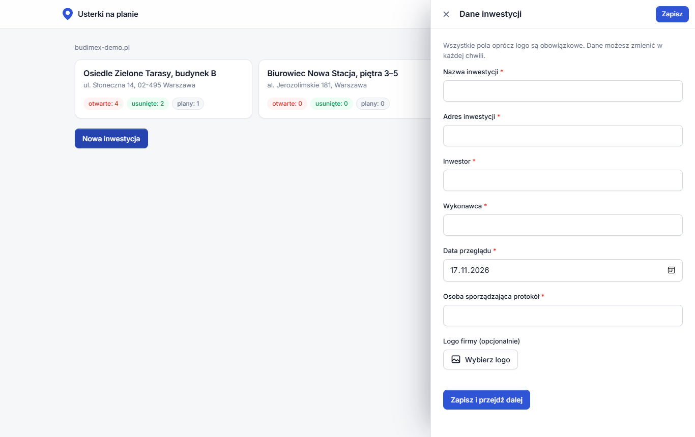
Nazwa, adres, inwestor, wykonawca, data przeglądu, autor protokołu, logo (opcjonalnie).

### 9. Strona startowa
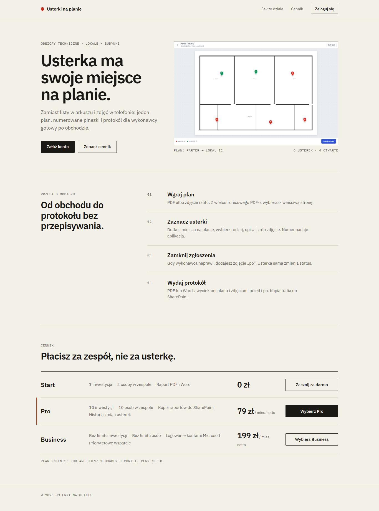
Publiczna wizytówka: opis, trzy kroki i cennik. Tu trafia każda niezalogowana osoba. Wersja mobilna: `mobile-09-strona-startowa.png`.

### 10–11. Logowanie hasłem i rejestracja
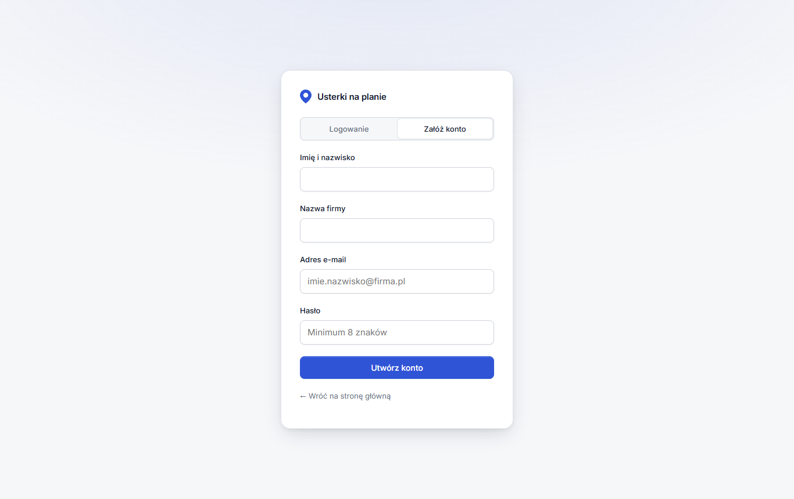
Dwie zakładki: logowanie i zakładanie konta. Rejestracja tworzy własną organizację, a osoba zostaje jej administratorem. Dodatkowo przycisk Microsoft (gdy skonfigurowany) i tryb dev (tylko lokalnie).

### 12. Subskrypcja
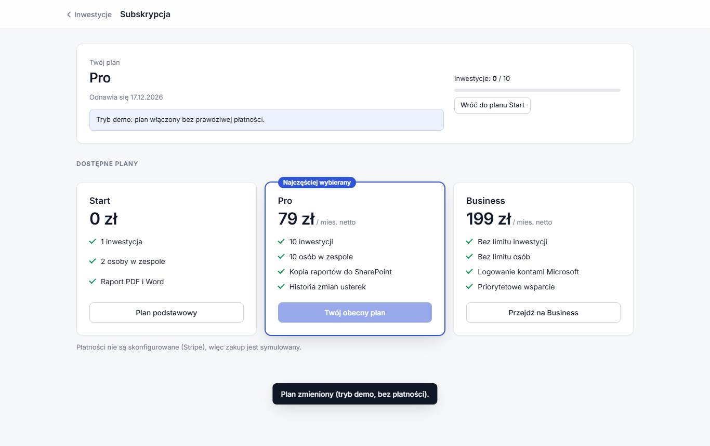
Aktualny plan, zużycie limitu inwestycji, zmiana planu (Stripe Checkout) i zarządzanie płatnościami (portal Stripe). Lokalnie bez kluczy Stripe zakup jest symulowany. Szczegóły: [06-subskrypcje-stripe.md](06-subskrypcje-stripe.md).

## 3. Architektura w pigułce

```
Przeglądarka (React SPA, :5173) ──Bearer token──▶ Django Ninja API (:8000/api) ──▶ baza + pliki
        │                                                │
        └── MSAL (logowanie Microsoft)                   └── Microsoft Graph → SharePoint
```

* **Backend** `application/` – Django 5 + Django Ninja. Moduły: `core` (autoryzacja, dostęp, pliki), `users`, `organizations`, `projects`, `plans`, `defects`, `reports`, `sharepoint`, `billing` (plany, limity, Stripe). Każdy ma `models.py`, `api.py`, czasem `services.py`.
* **Frontend** `usterka_frontend/src/` – `pages/` (ekrany), `components/` (klocki), `stores/` (Zustand: `authStore`, `projectStore`, `uiStore`), `service/` (wywołania API), `utils/` (obrazy, PDF, raporty), `css/` (style).
* Szczegóły: [architecture.md](architecture.md).

## 4. Gdzie co jest zapisane

| Dane | Gdzie | Uwagi |
|---|---|---|
| Użytkownicy, organizacje, role | Baza: SQLite `application/sqlite3.db` (lokalnie), PostgreSQL (Docker/produkcja, `DATABASE_URL`) | tabele `users_*`, `organizations_*` |
| Inwestycje, plany (metadane), usterki, historia zmian, raporty (metadane) | ta sama baza | `projects_*`, `plans_*`, `defects_*` (w tym `DefectEvent`), `reports_*` |
| Obrazy planów | dysk: `MEDIA_ROOT/org/<org>/projects/<proj>/plans/` | domyślnie `application/media/` |
| Zdjęcia usterek | `…/projects/<proj>/photos/` | kompresja do 1600 px po stronie przeglądarki |
| Logo inwestycji | `…/projects/<proj>/logo/` | |
| Wygenerowane raporty | `…/projects/<proj>/reports/` | |
| Subskrypcje (plan, status, identyfikatory Stripe) | ta sama baza, tabela `billing_subscription` | karty płatnicze trzyma wyłącznie Stripe |
| Hasła użytkowników | ta sama baza, tabela `users_user` | tylko skrót PBKDF2, nigdy jawny tekst |
| Kopia raportu | SharePoint (biblioteka z ustawień organizacji) | zapis kontem zalogowanej osoby |
| Token logowania | przeglądarka, `localStorage` (`usterka.authMode`, `usterka.devToken`) | w trybie Microsoft token trzyma MSAL w `localStorage` |
| Szkic niedokończonej usterki | przeglądarka, `localStorage` (`usterka.defectDraft`) | tylko pola tekstowe i położenie, **bez zdjęć** |

Pliki nie są publiczne – wydaje je API (`/plans/{id}/image`, `/photos/{id}/file`) po sprawdzeniu dostępu; frontend pobiera je z tokenem (`components/common/AuthImage.tsx`).

**Kopia zapasowa:** baza + katalog `MEDIA_ROOT` (w Dockerze to wolumeny).

## 5. Logika, którą warto znać

1. **Izolacja organizacji.** Każdy zasób jest szukany przez `core/access.py` z filtrem organizacji; cudza inwestycja = 404. Role: `admin` > `inspector` (zapis) > `viewer` (tylko podgląd – przyciski zapisu znikają: `canWrite()`).
2. **Pinezka = współrzędne względne.** `x, y ∈ [0, 1]` względem obrazu planu, więc nie zależą od rozdzielczości ani zoomu.
3. **Numer usterki** nadaje serwer (`select_for_update`), unikalny w inwestycji – dwie osoby naraz nie dostaną tego samego.
4. **Status wynika ze zdjęć.** Dodanie zdjęcia „po” → status `fixed` i data usunięcia; usunięcie wszystkich zdjęć „po” → znowu `open` (`defects/services.py: refresh_status`). Każda zmiana trafia do historii (`DefectEvent`: kto, co, kiedy).
5. **Dodanie planu.** PDF czytany w przeglądarce (pdf.js); przy wielu stronach wybierasz stronę, ta jest renderowana do obrazu i wysyłana jako JPEG/PNG. Serwer waliduje obraz (`core/files.py`, maks. 40 MB).
6. **Szkic usterki.** Każda zmiana w formularzu zapisuje się co 400 ms w `localStorage`; po powrocie do aplikacji można wrócić do niedokończonej usterki.
7. **Raport powstaje w przeglądarce** (`utils/report/pdf.ts` – jsPDF, `docx.ts` – docx, dane z `gather.ts`): nagłówek z logo, dane inwestycji, tabela usterek, całe plany z pinezkami, karty usterek (wycinek planu + zdjęcia przed/po), podpisy. Plik trafia do pobrania **i** `POST /projects/{id}/reports` (archiwum). Przy zaznaczeniu SharePoint backend używa przepływu On-Behalf-Of i Microsoft Graph (`sharepoint/graph.py`; pliki >4 MB sesją wysyłania).
8. **Logowanie hasłem.** `POST /auth/register|login` wydaje podpisany token `pwd.` (14 dni). Rejestracja = nowa organizacja, bez dołączania po domenie e-mail.
9. **Limity planu.** Serwer odrzuca (402) utworzenie inwestycji ponad limit planu (Start: 1, Pro: 10, Business: bez limitu). Plan ustala webhook Stripe: [06-subskrypcje-stripe.md](06-subskrypcje-stripe.md).
10. **Logowanie dev i Microsoft.** Tryb dev (`AUTH_DEV_LOGIN=1`) wydaje podpisany token 7-dniowy; tryb Microsoft waliduje JWT z Entra ID (`core/entra.py`). Konfiguracja: [05-konfiguracja-microsoft.md](05-konfiguracja-microsoft.md).

## 6. Uruchomienie i dane demo

```powershell
./scripts/install-local.ps1      # jednorazowo: .venv, zależności, migracje
./scripts/start-local.ps1        # backend :8000 + frontend :5173
.venv/Scripts/python scripts/seed-demo.py   # przykładowa inwestycja, plan i 6 usterek
```
Logowanie demo: `anna.kowalska@budimex-demo.pl`. Dokumentacja API: <http://127.0.0.1:8000/api/docs>.

## 7. Przeprojektowanie wyglądu (co się zmieniło)

Wzorzec: neutralny, gęsty styl narzędzi roboczych typu Linear / Fieldwire – bez „gadżetowych” elementów.

| Było | Jest |
|---|---|
| Barlow Condensed, żółta taśma ostrzegawcza, jaskrawy żółty baner | Inter, spokojne, jednolite tło; baner dev jako cicha notka |
| Pełnoekranowe formularze także na komputerze | Na desktopie panel boczny 520 px, na telefonie pełny ekran |
| Jedna wąska kolumna 720 px | Desktop: dane + plany po lewej, usterki po prawej; karty inwestycji w siatce |
| Wypełnione czerwone/zielone plakietki | Subtelne pigułki statusu (kolor + jasne tło) |
| Logowanie jako goły formularz | Wyśrodkowana karta z logo |
| Tło planu jednolite | Tło z siatką punktów (czytelniej, że plan można przesuwać) |

Cały system wyglądu to zmienne CSS na górze `usterka_frontend/src/css/app.css` (kolory, promienie, cienie, czcionka) – ciemny motyw działa automatycznie. Zmiana marki = zmiana `--accent`.

Porównanie przed/po: ten sam ekran w `screenshots/before/` i `screenshots/after/`.
