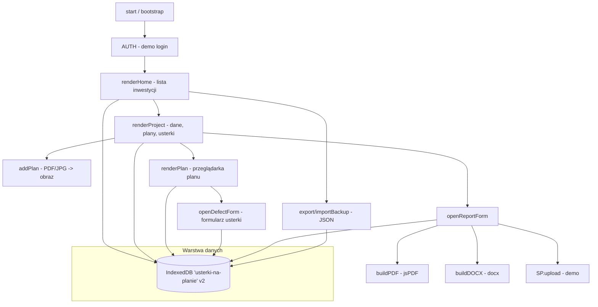
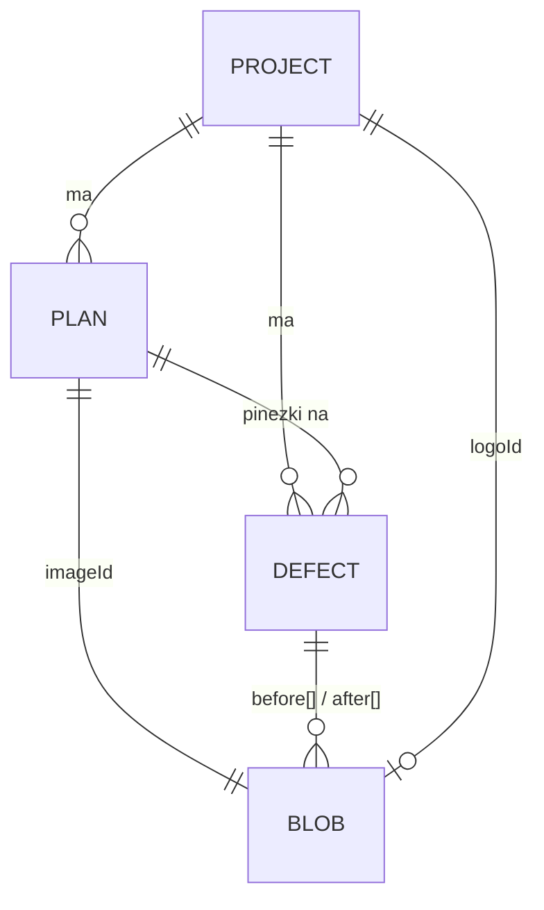

# 01. Jak to działa teraz

## 1. Struktura pliku

`usterki-na-planie.html` (~170 KB, ~900 linii):

| Linie | Zawartość |
|---|---|
| 1–183 | `<style>` – cały CSS, motyw jasny/ciemny przez zmienne CSS (`--accent`, `--open`, `--fixed`…) |
| 185–186 | Dwa fonty Carlito (regular/bold) jako base64 (~80 KB) – potrzebne jsPDF do polskich znaków |
| 188+ | Cała logika JS w jednym `<script>` (vanilla JS, bez frameworka, bez bundlera) |

Biblioteki zewnętrzne ładowane **na żądanie z CDN** (cdnjs / jsdelivr):

| Biblioteka | Wersja | Do czego |
|---|---|---|
| pdf.js | 3.11.174 | Renderowanie strony PDF do obrazu planu |
| jsPDF | 2.5.1 | Generowanie raportu PDF |
| docx | (CDN) | Generowanie raportu Word |

Po 4 s od startu aplikacja „rozgrzewa” te biblioteki w tle.

## 2. Moduły logiczne (sekcje w kodzie)

| Sekcja | Odpowiedzialność |
|---|---|
| `utils` | `uid()`, `esc()` (ochrona przed XSS), daty, toast, dialog (Promise), lightbox, `pickFiles` |
| `storage` | Wrapper na IndexedDB: `dbGet/dbAll/dbPut/dbDel`, blob store, cache `ObjectURL` i obrazów |
| `images` | Skalowanie zdjęć na canvasie, rysowanie pinezki, `renderCrop` (wycinek planu), `renderOverview` (cały plan z pinezkami) |
| `external libraries` | Leniwe ładowanie skryptów z CDN |
| `downloads` | Zapis pliku: `window.claude.use('downloads')` (gdy działa jako artefakt Claude) lub zwykły `<a download>` |
| `projects` | Lista, formularz, usuwanie inwestycji (kaskadowo) |
| `adding plans` | PDF → wybór strony → render do JPEG (maks. 3500 px, 13 MPx); JPG → skalowanie do 4000 px |
| `plan viewer` | Pan/zoom (Pointer Events, pinch, kółko, dwuklik), tryby `browse` / `add` / `move` |
| `defect form` | Formularz, walidacja, zdjęcia, autosave szkicu co 400 ms |
| `report` | Zbieranie danych, PDF i DOCX, zapamiętywanie ustawień raportu per inwestycja |
| `backup` | Eksport/import wszystkiego do JSON (bloby jako base64) |
| `sign-in / SharePoint` | **Atrapy** – `AUTH` i `SP` z flagą `demo:true` |

## 3. Model danych (IndexedDB)

Baza: `usterki-na-planie`, wersja `2`. Każdy store ma `keyPath: 'id'`.

**projects**
| Pole | Typ | Uwagi |
|---|---|---|
| id | string | `uid()` = timestamp base36 + losowe |
| name, address, investor, contractor, author | string | wszystkie wymagane |
| inspectionDate | `YYYY-MM-DD` | |
| logoId | string \| null | blob PNG, maks. 800 px |
| nextNo | number | licznik numerów usterek w inwestycji |
| reportSettings | obiekt | data, filtr, plany, logo, sp |
| createdAt, updatedAt | ms | |

**plans**
| Pole | Typ | Uwagi |
|---|---|---|
| id, projectId, name | string | |
| imageId | string | blob JPEG |
| w, h | number | rozmiar obrazu w px |
| createdAt | ms | |

**defects**
| Pole | Typ | Uwagi |
|---|---|---|
| id, projectId, planId | string | |
| no | number | numer porządkowy w inwestycji |
| x, y | 0..1 | **współrzędne znormalizowane** względem planu |
| type, typeOther | string | 6 typów: Budowlana, Sanitarna, Elektryczna, Instalacje budynkowe, Meble/wyposażenie, Inna |
| desc | string | |
| dueMode | `umowa` \| `data` | |
| dueDate | `YYYY-MM-DD` | |
| before[], after[] | string[] | id blobów zdjęć (maks. 1600 px, JPEG 0.82) |
| fixedDate | `YYYY-MM-DD` | |
| zoom | 0.1–0.6 | szerokość wycinka do raportu jako ułamek dłuższego boku planu |

**Status usterki nie jest zapisywany** – jest wyliczany: `usunięta` ⇔ `after.length > 0`.

**blobs** – `{id, type, buf: ArrayBuffer}`
**meta** – rekordy specjalne: `settings`, `session`, `draft`.

## 4. Przepływy krok po kroku

### 4.1 Start
1. Otwarcie IndexedDB; jeśli się nie da (tryb prywatny) → ekran błędu.
2. Prośba o `navigator.storage.persist()` (żeby przeglądarka nie czyściła danych).
3. Brak sesji → ekran logowania. Jest sesja → lista inwestycji + `checkDraft()`.
4. Po 4 s ładowanie bibliotek PDF/DOCX w tle.

### 4.2 Logowanie (demo)
1. Przy pierwszym uruchomieniu użytkownik podaje domenę firmy (np. `firma.pl`).
2. Wpisuje e-mail – sprawdzany jest tylko sufiks `@domena`.
3. Sesja = rekord `meta/session` w IndexedDB. **Brak hasła, brak weryfikacji.**

### 4.3 Inwestycja
1. 6 pól obowiązkowych + logo opcjonalne.
2. Bez kompletu danych nie można dodać planu.
3. Usunięcie inwestycji kasuje kaskadowo plany, usterki i wszystkie bloby.

### 4.4 Dodanie planu
1. PDF: pdf.js → jeśli >1 strona, ekran wyboru strony z miniaturami → render strony do JPEG.
2. JPG/PNG: skalowanie do maks. 4000 px / 12 MPx.
3. Nazwa planu (domyślnie nazwa pliku).
4. Zapis bloba + rekordu `plans`, przejście do przeglądarki planu.

### 4.5 Przeglądarka planu
- Transformacja CSS `translate + scale` na `.stage`; pinezki skalowane odwrotnie (`1/s`), żeby miały stały rozmiar.
- Gesty: 1 palec = przesuwanie, 2 palce = pinch zoom, kółko myszy, dwuklik = ×2.
- „Tap” = brak ruchu > 7 px i < 600 ms.
- Tryb `add`: tap → przeliczenie na `x,y ∈ [0,1]` → formularz.
- Tryb `move`: formularz chowa się, tap ustawia nowe miejsce.

### 4.6 Usterka
1. Wybór typu (chipy), opis, termin (umowa / data).
2. Podgląd wycinka planu na canvasie + suwak zasięgu.
3. Zdjęcia „przed” (aparat lub galeria) i „po”. Dodanie zdjęcia „po” = usterka usunięta, ustawia datę usunięcia.
4. **Autosave**: każda zmiana → po 400 ms zapis szkicu do `meta/draft`. Nowe zdjęcia trafiają od razu do `blobs` jako „pending”.
5. Zapis: walidacja → dla nowej usterki pobranie `project.nextNo` → zapis → usunięcie osieroconych blobów → skasowanie szkicu.
6. Zamknięcie bez zapisu → usunięcie zdjęć „pending”.
7. Po ponownym uruchomieniu `checkDraft()` proponuje powrót do niedokończonej usterki.

### 4.7 Raport
1. Opcje: data dokumentu, filtr (wszystkie/otwarte/usunięte), całe plany, logo, kopia do SharePoint.
2. Opcje zapamiętywane w `project.reportSettings`.
3. Struktura dokumentu (PDF i DOCX identyczna):
   1. Nagłówek + logo
   2. Tabela danych inwestycji
   3. Zestawienie usterek (tabela)
   4. Całe plany z pinezkami (strona pozioma/pionowa wg proporcji)
   5. Karty usterek: dane + wycinek planu + zdjęcia przed/po w 2 kolumnach
   6. Podpisy Inwestora i Wykonawcy
   7. Stopka „Strona X z Y”
4. Zapis pliku → opcjonalnie `SP.upload()` (symulacja, pokazuje docelową ścieżkę).

### 4.8 Kopia zapasowa
- Eksport: wszystkie store’y + bloby w base64 w jednym JSON.
- Import: nadpisuje rekordy o tych samych `id`, reszta zostaje (merge po id).

## 5. Gdzie to jest uruchamiane

Kod ma obsługę `window.claude.use('downloads')`, więc był pisany jako **artefakt Claude**. Działa też jako zwykły plik w przeglądarce telefonu. Komunikat w UI sugeruje otwarcie w Chrome/Safari, gdy nie działa wybór pliku (WebView).
