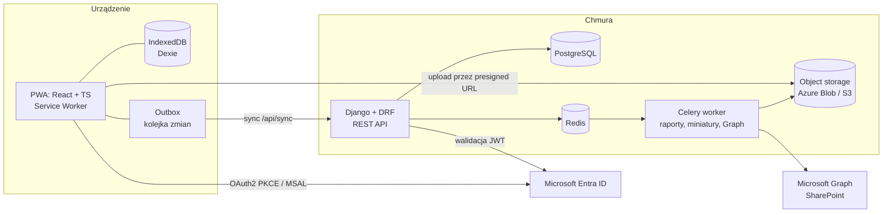
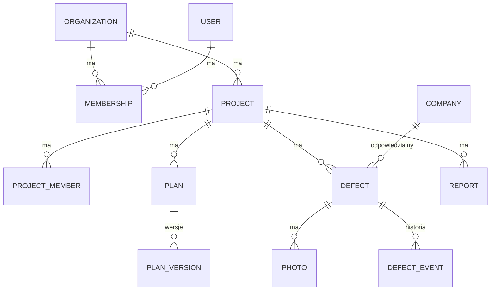

# 02. Architektura docelowa (pełny produkt)

## 1. Cele produktu

1. Wiele osób i urządzeń pracuje na tych samych inwestycjach.
2. Praca **offline na budowie** (piwnica, garaż podziemny = brak zasięgu) i synchronizacja po powrocie zasięgu.
3. Prawdziwe logowanie firmowe (Microsoft Entra ID) i role.
4. Raporty automatycznie trafiają do SharePoint.
5. Wykonawca/podwykonawca dostaje listę swoich usterek i sam dodaje zdjęcia „po”.
6. Wiele firm (multi-tenant) → model SaaS.

## 2. Widok z lotu ptaka



## 3. Frontend

| Element | Wybór | Dlaczego |
|---|---|---|
| Framework | React + TypeScript (alternatywa: Vue 3) | Obecny kod to ~900 linii w jednym pliku; komponenty i typy są konieczne przy 3+ osobach w zespole |
| Build | Vite | Szybki, prosty, wsparcie PWA przez `vite-plugin-pwa` |
| Lokalna baza | Dexie.js nad IndexedDB | Migracje schematu, indeksy, zapytania – obecny ręczny wrapper tego nie ma |
| Stan serwerowy | TanStack Query | Cache + retry + offline |
| Offline | Service Worker (Workbox) | Cache aplikacji **i bibliotek** (pdf.js, jsPDF, docx) – teraz bez internetu raport nie powstanie |
| Auth | MSAL.js (`@azure/msal-browser`) | Kod już ma komentarz, że docelowo ma być MSAL + Entra ID |
| Przeglądarka planu | Zostawić obecny silnik (Pointer Events + CSS transform) lub OpenSeadragon dla bardzo dużych planów | Obecny działa dobrze do ~13 MPx |
| Raporty | Na start: zostawić generowanie w przeglądarce (działa offline). Później: opcjonalnie serwer | |

### Proponowana struktura katalogów

```
frontend/
  src/
    app/            routing, layout, providers
    features/
      auth/
      projects/
      plans/        upload, PdfPagePicker, PlanViewer
      defects/      DefectForm, PhotoPicker, CropPreview
      reports/      pdf/, docx/, ReportForm
      sync/         outbox, syncEngine, conflict
      settings/
    lib/
      db.ts         Dexie, schemat, migracje
      images.ts     resize, renderCrop, renderOverview, drawPin
      api.ts
    assets/fonts/   Carlito (zamiast base64 w kodzie)
```

Kod z obecnego pliku, który da się przenieść prawie 1:1: `resizeImage`, `drawPin`, `renderCrop`, `renderOverview`, `renderPdfPage`, logika gestów, `buildPDF`, `buildDOCX`.

## 4. Backend

| Element | Wybór |
|---|---|
| API | Django 5 + Django REST Framework |
| Baza | PostgreSQL 16 |
| Pliki | Azure Blob Storage (spójne z M365) lub S3; upload bezpośrednio z telefonu przez **presigned URL** |
| Zadania w tle | Celery + Redis: miniatury, raporty serwerowe, wysyłka do SharePoint, e-maile |
| Auth | Walidacja tokenów JWT z Entra ID (`django-auth-adfs` / własna walidacja JWKS) |
| Uprawnienia | DRF permissions + filtrowanie po `organization_id` (multi-tenant na wspólnej bazie) |
| Hosting | Azure App Service / Container Apps (lub dowolny Docker) |

### Model danych (PostgreSQL)



Różnice względem obecnego modelu:

| Teraz | Docelowo | Powód |
|---|---|---|
| Brak organizacji | `Organization`, `Membership` (rola) | SaaS, wiele firm |
| `investor`, `contractor` jako tekst | Tabela `Company` + `defect.responsible_company_id` | Filtr „usterki podwykonawcy X”, portal wykonawcy |
| Status wyliczany z `after.length` | Pole `status`: `open` → `in_progress` → `fixed` → `verified` / `rejected` | Inspektor musi **potwierdzić** usunięcie; teraz zdjęcie „po” od razu zamyka usterkę |
| Brak historii | `DefectEvent` (kto, kiedy, co zmienił) | Spory z wykonawcą, audyt |
| Plan = 1 obraz | `PlanVersion` | Nowa rewizja rysunku bez gubienia pinezek |
| `before[]`, `after[]` | `Photo(kind, taken_at, author, gps?)` | Metadane, kolejność, podpis |
| Typy usterek na sztywno | Słownik per organizacja | Każda firma ma swoje kategorie |
| `id` = timestamp + random | UUID v7 generowany na urządzeniu | Tworzenie offline bez kolizji |

### Główne endpointy

```
POST   /api/auth/me                     profil + organizacje
GET    /api/projects/                   lista (filtr po organizacji)
POST   /api/projects/
GET    /api/projects/{id}/
POST   /api/plans/                      metadane planu
POST   /api/uploads/presign             {kind, contentType} -> {url, key}
POST   /api/sync                        push zmian z outboxa + pull zmian od `since`
POST   /api/projects/{id}/reports       zlecenie raportu serwerowego (opcjonalnie)
POST   /api/reports/{id}/sharepoint     wysyłka do SharePoint przez Graph
GET    /api/portal/{token}/defects      portal wykonawcy (link bez konta)
```

## 5. Synchronizacja offline (najtrudniejsza część)

### Zasada: offline-first z kolejką zmian (outbox)

1. Każda zmiana zapisuje się **najpierw lokalnie** (Dexie) + wpis do tabeli `outbox` (`entity`, `id`, `op`, `payload`, `clientTs`).
2. Zdjęcia: blob zostaje lokalnie, w outboxie zadanie „upload”. Upload przez presigned URL, potem rekord dostaje `storage_key`.
3. Gdy jest sieć (`online` event + co 30 s): `POST /api/sync` z paczką zmian (maks. ~100 operacji).
4. Serwer zwraca: potwierdzenia + zmiany innych od ostatniego `since` (kursor = `updated_at`/sekwencja).
5. Konflikty: **last-write-wins per pole** + zapis obu wersji w `DefectEvent`. Dla usterek to wystarcza w 95% przypadków.

### Numeracja usterek – problem do rozwiązania

Teraz `project.nextNo` jest liczony lokalnie. Przy 2 osobach offline obie dostaną nr 15.

| Opcja | Jak | Plus | Minus |
|---|---|---|---|
| A. Numer nadaje serwer | Offline usterka ma nr tymczasowy („T-3”), po sync dostaje właściwy | Zawsze ciągła numeracja | Raport offline ma numery tymczasowe |
| B. Pule numerów per urządzenie | Serwer przydziela urządzeniu zakres, np. 100–149 | Działa offline | Dziury w numeracji |
| C. Prefiks osoby | „JK-15”, „AN-3” | Prosto, zero konfliktów | Mniej „ładne” numery |
| **D. Blokada przeglądu (rekomendacja)** | Przegląd ma jednego prowadzącego; tylko on nadaje numery, inni mogą dodawać zdjęcia/komentarze | Zgodne z praktyką odbiorów, zero konfliktów | Wymaga pojęcia „sesji przeglądu” |

## 6. Integracja Microsoft 365

1. **Rejestracja aplikacji w Entra ID** (single-tenant na start, multi-tenant dla SaaS).
2. Frontend: MSAL, scope do własnego API.
3. Backend: wysyłka do SharePoint przez Microsoft Graph:
   - pliki < 4 MB: `PUT /sites/{site-id}/drive/root:/{path}:/content`
   - większe (raporty ze zdjęciami często 10–50 MB): `createUploadSession` + upload w kawałkach
4. Uprawnienia: `Sites.Selected` (dostęp tylko do wskazanej witryny) zamiast `Sites.ReadWrite.All`.
5. Obecne ustawienia (`spSite`, `spLibrary`, `spFolder` z `{inwestycja}`) przenieść 1:1 do ustawień organizacji.

## 7. Raporty: przeglądarka czy serwer?

| | Przeglądarka (teraz) | Serwer |
|---|---|---|
| Offline | ✅ | ❌ |
| Wydajność przy 200 usterkach × 4 zdjęcia | ❌ telefon może się zawiesić / zabraknąć pamięci | ✅ |
| Automatyczna wysyłka do SharePoint | Trzeba wysłać plik z telefonu | ✅ bez udziału użytkownika |
| Szablony per firma | Trudno | ✅ (np. DOCX-szablon + `docxtpl`, PDF przez WeasyPrint) |

**Rekomendacja:** zostawić oba. Telefon – szybki raport offline. Serwer – raport „oficjalny”, archiwizowany i wysyłany do SharePoint.

## 8. Bezpieczeństwo i RODO

1. Dane osobowe: imiona i nazwiska, adresy, zdjęcia (mogą zawierać ludzi, tablice rejestracyjne) → umowa powierzenia (DPA), rejestr czynności.
2. Hosting w UE (np. Azure West Europe / Poland Central).
3. Szyfrowanie w spoczynku (domyślne w Azure/S3) i TLS.
4. Lokalne dane na telefonie: wylogowanie = czyszczenie IndexedDB.
5. Linki portalu wykonawcy: losowy token, ważność np. 30 dni, możliwość unieważnienia.
6. Usuwanie EXIF/GPS ze zdjęć przed udostępnieniem na zewnątrz (opcja).
