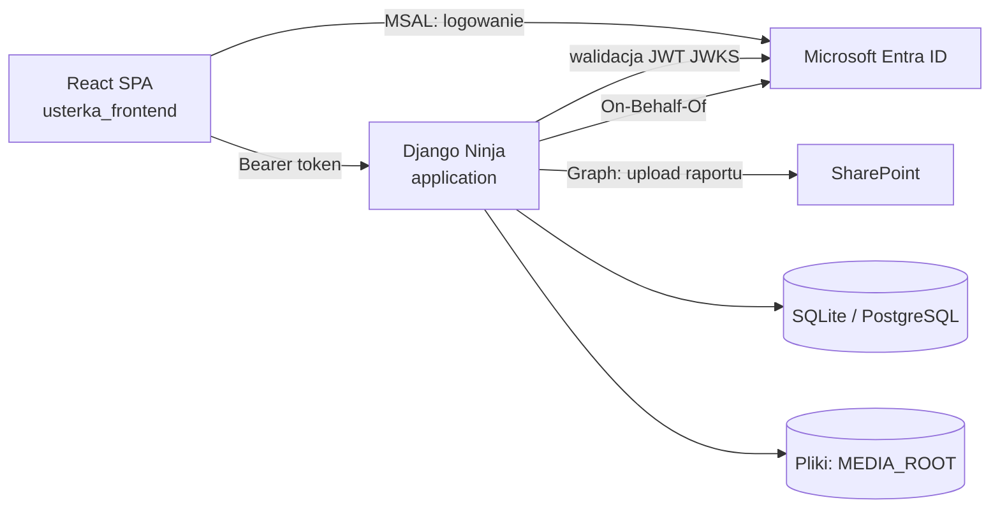
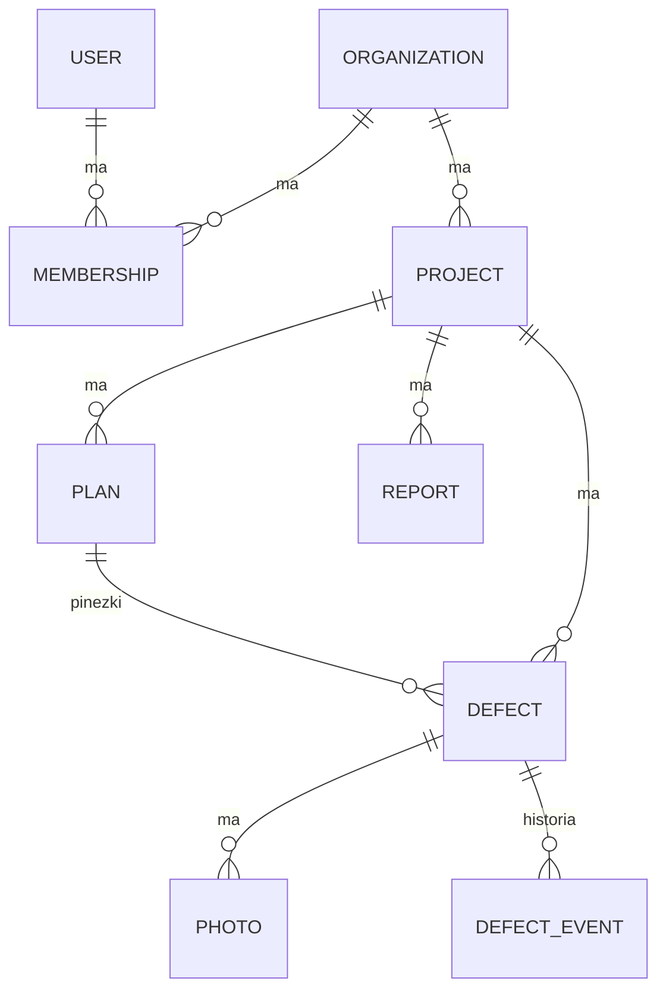

# Architektura

## Procesy

## Backend (`application/`)

| Aplikacja | Odpowiedzialność |
|---|---|
| `config/` | Settings (`base.py`, `test.py`), `api.py` – NinjaAPI i rejestracja routerów, `urls.py` |
| `core/` | `auth.py` (Bearer: token Microsoft lub dev), `entra.py` (walidacja JWT), `access.py` (izolacja organizacji, role), `files.py` (walidacja obrazów, wydawanie plików), `signals.py` (kasowanie plików z rekordami) |
| `users/` | `User` (e-mail, `entra_oid`), tworzenie konta z tokenu, logowanie dev, `/auth/*` |
| `organizations/` | `Organization` (dzierżawa Microsoft, rodzaje usterek, ustawienia SharePoint), `Membership` (rola) |
| `projects/` | `Project` (inwestycja), logo, ustawienia raportu, licznik numerów usterek |
| `plans/` | `Plan` – obraz podkładu (PDF renderuje przeglądarka) |
| `defects/` | `Defect`, `Photo`, `DefectEvent` (historia), numeracja pod blokadą, status z zdjęć „po” |
| `reports/` | `Report` – archiwum wygenerowanych protokołów + status SharePoint |
| `sharepoint/` | `graph.py` – OBO, znajdowanie witryny/biblioteki, upload prosty i sesyjny (>4 MB) |

Każdy moduł: `models.py`, `api.py` (router Ninja + schematy), `services.py` gdy logika jest większa, `admin.py`.

### Zasady

1. **Izolacja:** każdy zasób jest szukany przez `core.access.get_*` z filtrem `organization`. Obca inwestycja = 404.
2. **Role:** `admin` (ustawienia, role), `inspector` (zapis), `viewer` (podgląd).
3. **Pliki** nie są publiczne. Wydaje je API po sprawdzeniu dostępu (`/plans/{id}/image`, `/photos/{id}/file`…).
4. **Numer usterki** nadaje serwer pod `select_for_update` – dwie osoby nie dostaną tego samego numeru.
5. **UUID** generuje też klient (`DefectIn.id`) – przygotowanie pod pracę offline.

## Model danych

## API (pełna lista: `/api/docs`)

| Metoda | Ścieżka | Opis |
|---|---|---|
| GET | `/auth/config` | Konfiguracja logowania (bez tokenu) |
| POST | `/auth/dev-login` | Token dev (tylko `AUTH_DEV_LOGIN=1`) |
| GET | `/auth/me` | Użytkownik, organizacja, rola |
| GET/PATCH | `/organization/` | Ustawienia organizacji i SharePoint |
| GET/PATCH | `/organization/members[/{id}]` | Osoby i role |
| GET/POST | `/projects/` | Inwestycje |
| GET/PATCH/DELETE | `/projects/{id}` | |
| POST/DELETE/GET | `/projects/{id}/logo` | |
| PUT | `/projects/{id}/report-settings` | |
| GET/POST | `/projects/{id}/plans` | POST multipart: `name`, `image` |
| PATCH/DELETE | `/plans/{id}`, GET `/plans/{id}/image` | |
| GET/POST | `/projects/{id}/defects` | |
| GET/PATCH/DELETE | `/defects/{id}`, GET `/defects/{id}/events` | |
| POST | `/defects/{id}/photos` | multipart: `kind`, `file` |
| DELETE | `/photos/{id}`, GET `/photos/{id}/file` | |
| GET/POST | `/projects/{id}/reports` | POST multipart: plik + `send_to_sharepoint` |
| POST | `/reports/{id}/sharepoint` | Ponowna wysyłka |

## Frontend (`usterka_frontend/src/`)

| Warstwa | Katalog | Odpowiednik w lol_spy |
|---|---|---|
| Trasy | `router/` | `router/` |
| Layouty | `layouts/` | `layouts/` |
| Strony | `pages/` | `pages/` |
| Komponenty | `components/{common,project,plan,defect,report}` | `components/` |
| Stan | `stores/` (Zustand) | `stores/` (Pinia) |
| HTTP | `service/http.ts → httpAuth.ts → rest.ts → *Service` | `service/http.js → httpAuth.js → rest.js` |
| Logika bez UI | `utils/` (obrazy, PDF, raporty) | `utils/` |

### Przepływ: dodanie usterki

1. `PlanPage` → „Dodaj usterkę” → tryb `add` w `PlanViewer`.
2. Tap → `x, y ∈ [0,1]` → `DefectForm`.
3. Pola zapisują się co 400 ms jako szkic w `localStorage`.
4. Zapis: `POST /defects` → `POST /photos` (każde zdjęcie, po kompresji do 1600 px) → `DELETE /photos` (usunięte).
5. Zdjęcie „po” → serwer ustawia `status=fixed`.

### Przepływ: raport

1. `ReportSheet` zbiera usterki z `projectStore`.
2. `utils/report/pdf.ts` (jsPDF) lub `docx.ts` (docx) – generowanie w przeglądarce, obrazy pobierane przez API.
3. Plik trafia do pobrania + `POST /projects/{id}/reports` (archiwum).
4. Gdy zaznaczono SharePoint: backend → OBO → Graph → zapis kontem tej osoby.

## Co jeszcze nie jest zrobione

1. Praca offline (Service Worker + kolejka zmian). Teraz potrzebny jest internet.
2. Szkic usterki nie przechowuje nowych zdjęć (tylko pola).
3. Magazyn plików w chmurze (Azure Blob przez `django-storages`) – teraz dysk serwera.
4. Portal wykonawcy, powiadomienia e-mail, wersje planów (roadmapa w `03-roadmapa-produktu.md`).
